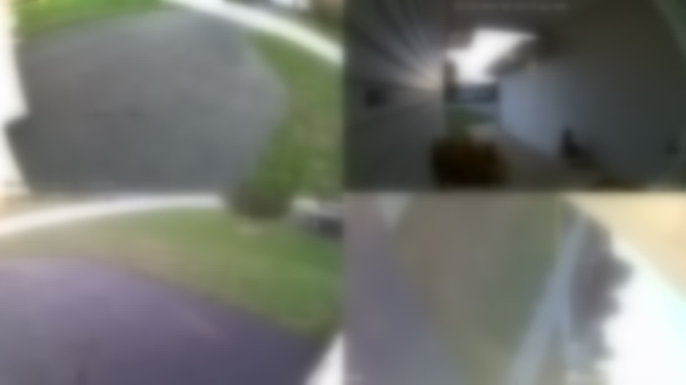

# ReolinkRokuTVClient

Live 2×2 wall of the 4 house cameras on the TV, via a Roku channel — fed only from
the **local** Reolink NVR. No Reolink cloud, no AWS relay.



*(a real frame off the live backend, all four tiles synced to within a couple seconds)*

## How it works

ffmpeg on the middleware box pulls the 4 camera RTSP streams from the NVR once,
stitches them into a single 2×2 video, and writes it out as HLS files that any
number of Rokus fetch over plain HTTP.

With 3 (or 30) Rokus watching, it's still the exact same stream. ffmpeg
encodes the mosaic once and writes the same segment files to disk; every Roku is
just an HTTP client downloading those files from the static file server
(port 8088). The NVR only ever sees the middleware's 4 connections, regardless of
how many TVs are watching.

## Layout

```
backend/     ffmpeg pipeline + a static HTTP server. Runs on an always-on Linux box.
docs/        FINDINGS.md — everything verified about the NVR, and why.
roku/        Roku channel (BrightScript). Plays the mosaic, d-pad cycles cameras.
scripts/     mosaic.sh (standalone test), probe-nvr.sh (re-run NVR discovery).
PLAN.md      background / history on how this got built.
```

## Redeploy the backend

```bash
cd backend
cp .env.example .env && $EDITOR .env       # first time only
SSH_HOST=me@reolinkstreamer.lan SUDO_PASS=... ./deploy.sh     # idempotent
```

## Install the Roku channel on another TV

```bash
cd roku
make install ROKU_HOST=<roku-ip> ROKU_PASS=<dev-password>
```

(Roku must have Developer Mode on: Home ×3, Up ×2, Right, Left, Right, Left, Right.)

## Stream endpoints

| Use | URL |
|---|---|
| The wall | `http://reolinkstreamer.lan:8088/mosaic/index.m3u8` |
| One camera | `http://reolinkstreamer.lan:8088/cam1/index.m3u8` (…`cam2`, `cam3`, `cam4`) |

## Credentials

The NVR account is a dedicated user-level login. Its credentials live only in
`backend/.env` (gitignored) — see `backend/.env.example` for the fields to fill
in. The Roku channel talks to the backend's HTTP server, not the NVR, so it
carries no secrets.
